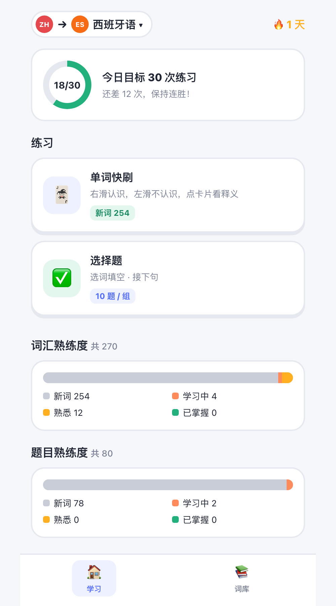
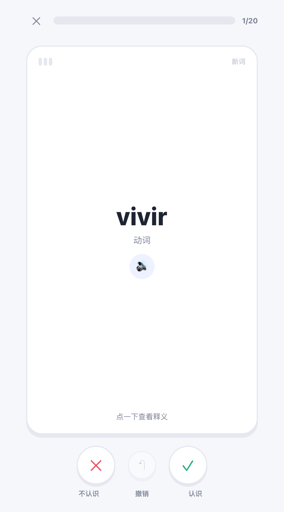
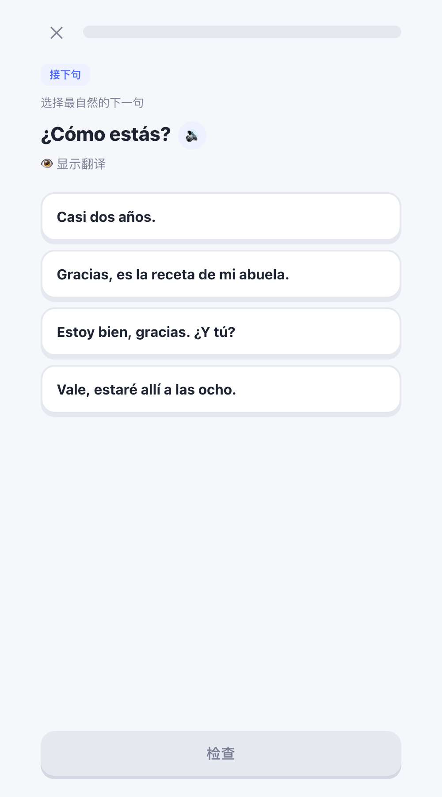
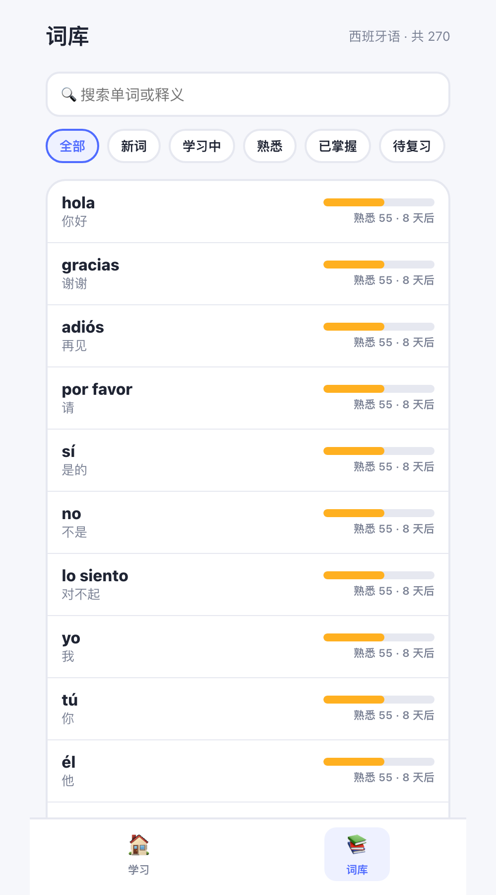

# Lingo

A Duolingo-style vocabulary app: learn Spanish, English, French or Chinese from any of the other three. FastAPI + SQLite backend, React frontend.

- **Word swipe**: swipe right if you know the word, left if you don't, and tap the card for the meaning in your native language plus an example sentence
- **Spanish course**: 3000+ words in 10 levels (A1→C1) with noun gender and example sentences; questions unlock level by level
- **Multiple choice**: fill-in-the-blank and "what comes next?" sentence questions
- **Mastery tracking**: a spaced-repetition score for every word and question, with due reviews mixed into each session
- **Daily goal and streak**, a searchable word list, text-to-speech, 4 UI languages, dark mode
- **Google sign-in** (optional): progress is saved to your account and follows you across devices; without it the app runs as a single local user

| Home | Word swipe | Multiple choice | Word list |
|---|---|---|---|
|  |  |  |  |

Setup and design notes: [DEVELOPMENT.md](DEVELOPMENT.md)
